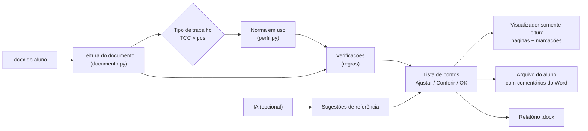

# Normalização ABNT — Biblioteca da EESC-USP

Ferramentas da Biblioteca da Escola de Engenharia de São Carlos (EESC-USP) para conferir a formatação de
**TCCs, dissertações e teses** segundo as **Diretrizes para apresentação de dissertações e teses
da USP: parte I (ABNT), 5. ed., 2024** e o **template oficial da EESC**.

O projeto tem duas partes independentes:

| Parte | O que é | Para quem |
|---|---|---|
| [**Verificador ABNT**](verificador-interno/) | Aplicativo que lê o trabalho (`.docx` ou PDF), aponta tudo o que está fora da norma, mostra o trabalho página por página (como num leitor de PDF) com cada ponto marcado, e gera o arquivo do aluno com comentários (no Word ou no PDF) e o relatório. **Não altera o trabalho**: quem corrige é o aluno. | Equipe da Biblioteca (e alunos, se o site público estiver ligado) |
| [**Assistente para alunos**](assistente-alunos/) | Instruções e base de regras para criar um GPT (ChatGPT), Gem (Gemini) ou Projeto (Claude) que tira dúvidas de normalização. | Alunos |

---

## Sumário

1. [O que o verificador faz](#1-o-que-o-verificador-faz)
2. [Como ele funciona por dentro](#2-como-ele-funciona-por-dentro)
3. [O que é conferido](#3-o-que-é-conferido)
4. [Visualizador e comentários](#4-visualizador-e-comentários)
5. [Revisão das referências por IA](#5-revisão-das-referências-por-ia)
6. [Normas: TCC, dissertação/tese e normas próprias](#6-normas-tcc-dissertaçãotese-e-normas-próprias)
7. [O que o usuário recebe](#7-o-que-o-usuário-recebe)
8. [Formas de uso: PC, rede da biblioteca e site público](#8-formas-de-uso-pc-rede-da-biblioteca-e-site-público)
9. [Privacidade e segurança](#9-privacidade-e-segurança)
10. [Instalação](#10-instalação)
11. [Assistente para os alunos](#11-assistente-para-os-alunos)
12. [Estrutura do repositório](#12-estrutura-do-repositório)
13. [Desenvolvimento, testes e versões](#13-desenvolvimento-testes-e-versões)
14. [Limitações](#14-limitações)

---

## 1. O que o verificador faz

Em poucos segundos, a partir do arquivo do aluno (`.docx` do Word ou PDF):

- **Identifica o tipo de trabalho** (TCC, dissertação ou tese) pela folha de rosto e aplica a norma certa.
- **Confere mais de 100 pontos da norma**: margens, fontes, espaçamentos, citações, referências, títulos,
  sumário, listas, ilustrações, tabelas, elementos pré-textuais, consistência entre as partes do trabalho e
  tipografia.
- **Mostra o trabalho como num leitor de PDF**, página por página e com a mesma paginação do Word, com **todos
  os problemas marcados e numerados** no texto e na margem. Clicar numa marcação mostra o que está errado e como
  corrigir; clicar num item da lista leva até o trecho.
- **Somente leitura**: o verificador não edita nem corrige o trabalho. Ele aponta; quem corrige é o aluno, no
  Word.
- **Revisa as referências com IA** (no próprio computador ou com chave do Gemini, ChatGPT, Claude...), com uma
  sugestão de referência correta para cada uma, que entra como comentário.
- **Gera os arquivos de devolução**: o **arquivo do aluno com comentários** em cada ponto (comentários do Word no
  `.docx`; destaques e notas no PDF, como no Acrobat; o texto não muda) e o **relatório** em `.docx`.

> Aceita **`.docx`** e **PDF** gerado pelo editor de texto (Word, LibreOffice, LaTeX, Google Docs). `.doc`, `.odt`
> e PDF digitalizado (imagem) não são aceitos.

**Como o PDF é lido.** O PDF não tem parágrafos nem estilos, só caracteres desenhados em posições. Como fazem os
extratores de estrutura de artigos científicos (GROBID, CERMINE), `verificador/pdf.py` remonta o trabalho a partir
do layout: junta os caracteres em linhas e as linhas em parágrafos (pelo espaço entre linhas, recuo, linha que
termina antes da margem e mudança de fonte), separa cabeçalho, número de página e notas de rodapé, reconhece
tabelas (com fios, só com fios horizontais no padrão IBGE ou sem fio, pelas colunas alinhadas) e figuras, e mede
margens, alinhamento, recuos e entrelinhas (com a régua do LaTeX quando o PDF vem dele). O resultado passa pelas
mesmas verificações do `.docx`. Margens e paginação são medidas na própria página (`pdf_regras.py`). No
visualizador aparece a página real, com uma camada de texto transparente por cima (como no pdf.js), e cada
caractere guarda a sua posição: as marcações caem exatamente no trecho, na tela e no PDF devolvido ao aluno.
O que só existe no Word (estilos, numeração automática, alterações controladas) não é avaliado no PDF.

---

## 2. Como ele funciona por dentro



**1. Leitura do documento.** O `.docx` é aberto com `python-docx` e transformado numa sequência de *blocos*
(parágrafos e tabelas, na ordem, inclusive os que ficam dentro de controles de conteúdo, como o sumário
automático do Word). Para cada bloco o verificador calcula a formatação **efetiva**: se o tamanho da fonte não
está no parágrafo, ele sobe pela cadeia de estilos do Word até os padrões do documento, como o próprio Word faz.
Depois localiza a introdução e as referências e divide o trabalho em parte **pré-textual**, **textual** e
**pós-textual**.

**2. Identificação tolerante.** Os trabalhos nem sempre seguem o modelo, então a identificação aceita
variações (a abordagem segue a de extratores de estrutura como GROBID e CERMINE: primeiro dividir o trabalho
em zonas, depois reconhecer cada elemento por vários sinais juntos, como texto, posição e formatação):
- títulos com pontuação ou minúsculas ("Introdução:", "Resumo"), com "CAPÍTULO 1 – ...", ou com erro de
  digitação ("Referencias"), achados por semelhança e marcados para conferência;
- títulos de seção reconhecidos pelo número (1, 2.1, 3.2.1...), mesmo sem estilo do Word;
- referências quebradas em várias linhas, juntadas numa só;
- legendas distinguidas de frases do texto ("Figura 3 mostra que..." não é legenda);
- textos dentro de caixas de texto e arquivos convertidos de PDF, que recebem um aviso;
- títulos com letras espaçadas ("R E S U M O") ou enfeites ("– RESUMO –");
- palavras-chave com o rótulo escrito de outro jeito ("Palavras chave –", "PALAVRAS-CHAVES.", "Key words"),
  sozinho na linha ou colado no resumo por uma quebra de linha;
- texto sem o título "INTRODUÇÃO": a parte textual começa na primeira seção "1 ..." (com aviso para conferir);
- a lista de referências termina no próximo título de seção, apêndice ou anexo;
- citações de entidades com nome longo ("A Universidade de São Paulo (2014)") e nomes com espaço faltando na
  referência ("NÍVELSUPERIOR");
- títulos "centralizados à mão" (com recuo ou espaços) separados dos que não estão centralizados.

**Cada apontamento sabe de onde veio.** Como nos verificadores de manuscritos (Penelope, Recite), cada
problema guarda o parágrafo e o trecho exato que o geraram, e é ali que a marcação aparece. Quando só há o
texto, a busca escolhe a ocorrência na zona certa, e não a linha do sumário ou da lista de figuras que repete
o mesmo texto.

**3. Verificações.** Cada módulo de regras devolve uma lista de pontos com:
**status** (*Ajustar* = fora da norma; *Conferir* = depende de avaliação humana; *OK*), detalhe, como corrigir,
seção da norma e a posição exata no documento.

**4. Norma em uso.** Todos os valores (margens, tamanhos, recuos, elementos obrigatórios...) vêm do **perfil de
norma** escolhido. Nada fica fixo no código: trocando a norma, a verificação muda junto.

**5. Desempenho.** São mais de 100 verificações, e cada uma lê os mesmos parágrafos. Para não repetir trabalho,
a camada de cache (`verificador/cache.py`) guarda o que não muda enquanto o documento é lido:
- o estilo de cada parágrafo e a cadeia de estilos-base;
- as expressões de busca no XML, compiladas uma vez só;
- durante a análise, a formatação efetiva de cada parágrafo, o texto, a lista de referências e os títulos
  encontrados.

O cache é transparente, ou seja, com ou sem ele os resultados são idênticos, e um teste confere isso. Um TCC de
80 páginas é analisado em menos de meio segundo (a versão 1.12 levava 2,5 s).

---

## 3. O que é conferido

### Formatação
- Papel A4 e **margens** de cada seção do Word (inclusive medianiz e margens espelhadas).
- **Fonte 12** e **entrelinhas 1,5** no texto; fonte menor em citações longas, notas, legendas e fontes.
- **Citações com mais de 3 linhas**: recuo de 4 cm, fonte menor, espaço simples, sem aspas. Parágrafos recuados
  sem sinal de citação (listas, etapas) não são confundidos.
- Mesma **família de fonte**, mesmo **alinhamento** e mesmo **recuo de parágrafo** no texto corrido.
- Texto em **preto**, sem realce ou cor esquecidos.
- **Paginação**: campo de página no cabeçalho, à direita, a partir da introdução, em fonte menor.
- **Notas de rodapé** em fonte 10/11 e espaço simples.

### Estrutura e elementos
Cada elemento (capa, folha de rosto, ficha catalográfica, errata, folha de aprovação, dedicatória,
agradecimentos, declaração de IA, epígrafe, resumo, abstract, listas, sumário, introdução, conclusão,
referências, glossário, apêndices, anexos e índice) é procurado no **arquivo inteiro** e conferido em três
frentes:

| Pergunta | Exemplos |
|---|---|
| **Aparece?** | obrigatório, condicional ou opcional, conforme o tipo de trabalho |
| **Está formatado?** | título sem número, centralizado e em maiúsculas; nota de natureza recuada à direita; resumo em parágrafo único |
| **É verdade?** | autor, título e ano iguais na capa, folha de rosto, ficha e referência do resumo; orientador igual na folha de rosto e na ficha; nº de palavras-chave = nº de keywords |

E também: ordem dos elementos; resumo com 150 a 500 palavras; palavras-chave separadas por ponto; referência do
trabalho acima do resumo e do abstract; nota de natureza coerente (tese ↔ Doutor, dissertação ↔ Mestre);
declaração de uso de IA generativa com uma só opção; frases obrigatórias de fomento (CAPES "Código de
Financiamento 001", nº do processo FAPESP); textos de exemplo do template esquecidos ("NOME DO AUTOR",
"Palavra-chave 1"...).

### Seções e títulos
- Numeração progressiva sem saltos, até a seção quinária.
- Título sem ponto final, alinhado à esquerda, separado do número por um espaço, sem texto na mesma linha.
- Seção primária em nova página; toda seção com texto; destaque uniforme por nível.
- Títulos sem indicativo numérico (RESUMO, SUMÁRIO, REFERÊNCIAS...) centralizados e sem número.

### Sumário e listas
- **Sumário × títulos**: mesma numeração e mesmas palavras; títulos que faltam; linhas que não existem no texto.
- **Números de página** do sumário e das listas comparados com a paginação que o Word grava ao salvar o arquivo.
- Sumário sem elementos pré-textuais; "Índice" usado no lugar de "Sumário".
- Listas de figuras, tabelas, quadros e gráficos × legendas do texto.
- Lista de siglas: siglas usadas no texto, siglas do texto que faltam e ordem alfabética.

### Ilustrações e tabelas
- Título acima ("Figura 1 – ...") e fonte abaixo, em fonte menor; numeração sequencial; palavra designativa
  no padrão (não "FIGURA" nem "Fig.").
- Toda ilustração citada no texto; toda imagem com título.
- **Tabelas** identificadas e classificadas (tabela de dados, quadro, tabela usada só para diagramar,
  ilustração), com título, fonte, bordas abertas nas laterais, repetição do cabeçalho e menção no texto.

### Citações e referências
- **Citação × referência** por três métodos independentes: ligação exata (sobrenome + ano), tolerante
  (sobrenome no início da referência + ano) e por grafia parecida (erro de digitação). Só é "sem referência" se
  os três falharem; se só o exato falhar, vira "grafias diferentes" para conferir.
- Toda referência citada no texto; citação direta com página; autor em maiúsculas e minúsculas na chamada
  (NBR 10520:2023); autores separados por ";" dentro dos parênteses; mesmo autor e ano com 2020a/2020b.
- **Referências**: entrada pelo SOBRENOME; título em destaque uniforme; ponto final; "Disponível em:" e
  "Acesso em: dia mês. ano."; meses abreviados; "2. ed."; "p."; "In:"; DOI; espaço simples e uma linha em
  branco entre elas; alinhadas à esquerda; ordem alfabética pelo autor; referências repetidas; ano no futuro.

### Consistência e tipografia
- Toda "Figura 3", "Tabela 2", "seção 2.1" e "Apêndice A" citada no texto existe.
- Sigla escrita por extenso na primeira menção ("Universidade de São Paulo (USP)").
- Espaços duplos, espaço antes da pontuação, parênteses e aspas sem par.
- Obra da epígrafe nas referências; errata com o quadro Folha / Linha / Onde se lê / Leia-se.

---

## 4. Visualizador e comentários

O verificador **não altera o trabalho do aluno**. Ele mostra e aponta; as correções são feitas pelo aluno, no
Word. Desde a versão 3.0 não existe correção automática nem edição pela tela.

**Visualizador (somente leitura, como um leitor de PDF)**
- **Páginas reais**: quando o arquivo foi salvo no Word, as páginas seguem a paginação que o próprio Word gravou
  (a página 12 daqui é a página 12 que o aluno viu, incluindo versos em branco). Arquivos de outros programas
  são paginados pela altura do conteúdo.
- **Todas as marcações à vista**: cada problema fica realçado no texto (vermelho = *Ajustar*, amarelo =
  *Conferir*) ou com uma barra na margem, quando vale para o parágrafo ou a tabela inteira. Um balão numerado na
  margem direita identifica cada ponto, na ordem em que aparecem no texto.
- **Clique numa marcação** para ver o que está errado, como corrigir e a seção das Diretrizes. **Clique num item
  da lista** para ir até o trecho (com ‹ › entre as ocorrências).
- **Barra de ferramentas**: página atual e ir para página, zoom (largura e página inteira), procurar no texto
  (Ctrl+F), mostrar/ocultar as marcações, mostrar as margens e **imprimir ou salvar em PDF com as marcações**.
- Filtros por situação (Ajustar, Conferir, OK) valem para a lista e para as marcações. A lista pode ser ordenada
  por tema ou pela ordem no texto, e cada item mostra a página.

**Arquivo com comentários** (`nome_comentado.docx`)
- É o `.docx` do aluno **exatamente como foi enviado**, com um comentário do Word em cada ponto (autor
  "Biblioteca EESC (verificador)"): o que está errado, como corrigir e a seção das Diretrizes. O trecho fica
  realçado em amarelo.
- Problemas que se repetem no texto todo (fonte, entrelinhas...) recebem um comentário só, com a dica de como
  corrigir tudo de uma vez pelo estilo do Word.
- Um teste automático confere que o texto do arquivo comentado é idêntico ao enviado.

---

## 5. Revisão das referências por IA

As referências são enviadas em lotes para um modelo de linguagem, que devolve para cada uma o diagnóstico e a
referência corrigida no padrão da norma, a partir de modelos por tipo de documento (livro, capítulo, artigo,
tese, evento, norma, legislação, documento on-line...).

| Provedor | Como funciona |
|---|---|
| **Ollama (local)** | IA no próprio computador, instalada junto com o verificador (`qwen2.5` 7b ou 3b, conforme a memória). Nada sai do PC. |
| **Gemini, ChatGPT, Claude e compatíveis** | Com uma chave de API da biblioteca: mais rápido e mais preciso. Só o texto das referências é enviado. |

Os pedidos são agrupados em lotes e feitos em paralelo. Quando a cota acaba, o verificador para com uma
mensagem clara, separando o limite por minuto do limite diário. As sugestões aparecem marcadas no documento e
entram como comentário no arquivo do aluno, para ele conferir e aplicar.

---

## 6. Normas: TCC, dissertação/tese e normas próprias

- **Escolha inicial**: *Detectar pelo arquivo*, *TCC* ou *Dissertação ou Tese*. Na detecção, o tipo é lido da
  nota de natureza da folha de rosto ou da referência do resumo.
- **Duas normas prontas da EESC**:
  - **TCC**: Diretrizes USP aplicadas ao TCC de graduação;
  - **Dissertação/Tese**: template oficial da EESC (versão corrigida/original, declaração de IA, citação longa
    em fonte 11...). O template pode ser baixado pelo próprio app.
- **Normas próprias** (✏️ *Criar ou editar norma*): margens, fontes, entrelinhas, citação longa, resumo, autor
  nas citações — (Silva, 2020) ou (SILVA, 2020) —, separador de autores, título e destaque das referências,
  elementos exigidos, **regras extras** (proibir ou exigir um texto, inclusive com expressão regular) e
  **instruções para a IA**.
- **Ler o manual de outra instituição com IA**: envie o PDF ou Word do manual; a IA preenche a norma para você
  conferir.
- Uma norma pode ser usada só na sessão, salva para todos (administrador) ou baixada e importada como `.json`.

---

## 7. O que o usuário recebe

| Saída | O que é |
|---|---|
| **Tela de trabalho** | Indicadores (Ajustar, Conferir, OK, comentários), lista de pontos com filtros e busca, e o visualizador somente leitura com as páginas e todas as marcações. |
| **Elementos do trabalho** | Tabela de cada elemento: aparece · formatação · conteúdo. |
| **Arquivo com comentários** | O arquivo do aluno **sem nenhuma alteração no texto**, com um comentário do Word em cada ponto a corrigir e o trecho destacado. |
| **Relatório** | `.docx` com a tabela de elementos, os pontos por categoria, como corrigir e a seção da norma. |
| **PDF com as marcações** | Pelo botão 🖨 do visualizador: imprime ou salva as páginas com os realces e os números. |

---

## 8. Formas de uso: PC, rede da biblioteca e site público

| Modo | Como | Para quê |
|---|---|---|
| **Aplicativo** | atalho *Verificador ABNT* | uso no PC da biblioteca, em janela própria |
| **Servidor na rede** | `servidor.bat` | um PC roda e todos da biblioteca acessam pelo navegador, sem instalar nada |
| **Site público** | `publicar.bat` | alunos acessam por um link na internet, com o app rodando no PC da biblioteca (Tailscale, Cloudflare ou túnel rápido) |

No **site público**:
- configurações e chaves só abrem com a senha de administrador;
- há limites de uso por pessoa e por dia;
- aparece um aviso de privacidade;
- o arquivo fica só na memória e é apagado em até 1 hora.

Outros recursos de uso:
- modo claro e escuro;
- tela cheia;
- recarregar a página não perde o trabalho aberto;
- atualização automática ao instalar uma versão nova.

---

## 9. Privacidade e segurança

- O trabalho é processado **no computador da biblioteca**. Com a IA local, nada sai do PC; com provedores de
  nuvem, só o texto das referências é enviado.
- Chaves de API e senhas ficam em `config.json`, nunca são enviadas ao navegador e as senhas são guardadas com
  hash (PBKDF2).
- **Nenhum trabalho de aluno entra neste repositório**: o `.gitignore` bloqueia `.docx` fora dos exemplos, além
  de `config.json`, logs e normas locais, e o script de envio recusa esses arquivos.

---

## 10. Instalação

**Windows, sem administrador:**
1. Baixe `verificador_abnt_eesc_vX.zip` em **Releases** e extraia.
2. Dois cliques em **`instalar.bat`**. Ele instala Python 3.12, as bibliotecas, o Ollama e o modelo de IA, e
   cria os atalhos.
3. Abra o atalho **Verificador ABNT**.

**Para atualizar:** extraia a versão nova por cima da pasta e abra o atalho. O app percebe a mudança e
instala ou repara o que faltar.

Manual completo, com servidor, site público, IA e solução de problemas:
[`verificador-interno/LEIA-ME.md`](verificador-interno/LEIA-ME.md).

---

## 11. Assistente para os alunos

Kit para publicar um assistente de normalização no ChatGPT (GPT personalizado), Gemini (Gem) ou Claude
(Projeto), como o assistente da UDESC. Ele traz as instruções de comportamento, uma base de regras resumida das
Diretrizes USP para a EESC e o PDF oficial como conhecimento. O assistente **orienta**; quem confere o arquivo é
o verificador. Veja [`assistente-alunos/`](assistente-alunos/).

---

## 12. Estrutura do repositório

```
.
├── verificador-interno/        app do verificador (é o que vai no .zip de instalação)
│   ├── app.py                  interface (Streamlit)
│   ├── verificador/
│   │   ├── documento.py        leitura do .docx, regiões, identificação tolerante de títulos
│   │   ├── pdf.py              leitura do PDF: estrutura remontada pelo layout, páginas e notas no PDF
│   │   ├── pdf_regras.py       margens, paginação e notas medidas na página (PDF)
│   │   ├── docx_util.py        formatação efetiva (cadeia de estilos do Word)
│   │   ├── estrutura.py        margens, texto, citações longas, elementos, seções, ilustrações
│   │   ├── tabelas.py          identificação e verificação de tabelas e quadros
│   │   ├── referencias.py      citações × referências e formato das referências
│   │   ├── extras.py           sumário × títulos, listas × legendas, regras próprias
│   │   ├── trabalho.py         TCC × pós e pré-textuais do template EESC
│   │   ├── elementos.py        aparece · formatação · conteúdo de cada elemento
│   │   ├── tipografia.py       verificações que não dependem do modelo
│   │   ├── perfil.py           normas (EESC TCC, EESC pós, normas próprias)
│   │   ├── texto.py            leitura do texto visível dos parágrafos (somente leitura)
│   │   ├── anotacao.py         original com comentários do Word
│   │   ├── relatorio.py        relatório .docx
│   │   ├── visualizacao.py     documento em folhas A4 e localização dos pontos
│   │   ├── ia_provedores.py    Ollama, Gemini, OpenAI, Claude e compatíveis
│   │   ├── configuracao.py     config.json, chaves e senhas
│   │   └── cache.py            aceleração transparente (estilos, XPath, leituras da análise)
│   ├── componentes/            área de trabalho (lista + documento)
│   ├── assets/                 ícone e template EESC
│   ├── exemplos/               documentos de exemplo e geradores
│   ├── tests/                  testes: regras, robustez, cache e retrato dos resultados
│   ├── instalar.ps1/.bat       instalação e atualização
│   ├── servidor.py/.bat        servidor na rede e site público
│   ├── publicar.ps1/.bat       túnel do site público
│   └── LEIA-ME.md              manual de uso
├── assistente-alunos/          kit do GPT/Gem/Projeto
├── docs/                       arquitetura, desenvolvimento, publicação no GitHub
├── scripts/                    envio ao GitHub e geração dos pacotes
├── .github/                    testes automáticos, lint, versões, modelos de issue/PR
├── ruff.toml                   regras do lint
└── CHANGELOG.md                histórico de versões
```

---

## 13. Desenvolvimento, testes e versões

```bash
cd verificador-interno
pip install -r requirements.txt pytest ruff
python -m pytest            # todos os testes (cerca de 1 minuto)
ruff check ..               # lint
streamlit run app.py        # abre o app no navegador
```

- **Testes** (rodam sozinhos no GitHub a cada envio, em Linux e Windows, junto com o lint e a checagem dos
  scripts do Windows):
  - **regras**: exemplos com erros plantados (dissertação e TCC), exemplos corretos que devem sair com zero
    alertas, documento fora do modelo, normas personalizadas e template EESC;
  - **somente leitura**: o arquivo com comentários tem exatamente o texto enviado; o visualizador não tem edição;
    as páginas seguem a paginação do Word;
  - **robustez**: 17 documentos estranhos gerados em `tests/sinteticos.py` (vazio, só tabela, equações, campos,
    controles de conteúdo, estilos quebrados, tabelas aninhadas...) passam por todas as funções sem erro;
  - **cache**: os mesmos documentos com o cache ligado e desligado dão resultados idênticos;
  - **retrato**: `tests/retrato_esperado.json` guarda tudo o que o verificador produz para os documentos
    públicos (achados, páginas, comentários e relatório). Se uma mudança altera algum resultado, o
    teste mostra o quê. Quando a mudança é de propósito, rode `python tests/retrato.py --atualizar` e confira a
    diferença no commit.
- **Versões**: ao criar uma release com a tag `vX.Y.Z` (igual a `verificador-interno/VERSION`), o GitHub roda
  os testes e anexa os pacotes de instalação.
- Para criar uma verificação nova: [`docs/desenvolvimento.md`](docs/desenvolvimento.md). Arquitetura:
  [`docs/arquitetura.md`](docs/arquitetura.md). Contribuições: [`CONTRIBUTING.md`](CONTRIBUTING.md).

---

## 14. Limitações

- O verificador **apoia** a revisão da Biblioteca, não a substitui. Itens marcados como *Conferir* precisam de
  um olhar humano.
- A paginação real só é conferida quando o arquivo foi salvo pelo Word, que grava as quebras de página.
- Em arquivos convertidos de PDF, algumas comparações de formatação são desligadas para evitar alarmes falsos.
- A IA pode errar: as sugestões de referência são sempre apresentadas para aprovação.
- Conteúdo dentro de imagens (gráficos, equações em imagem) não é lido.
